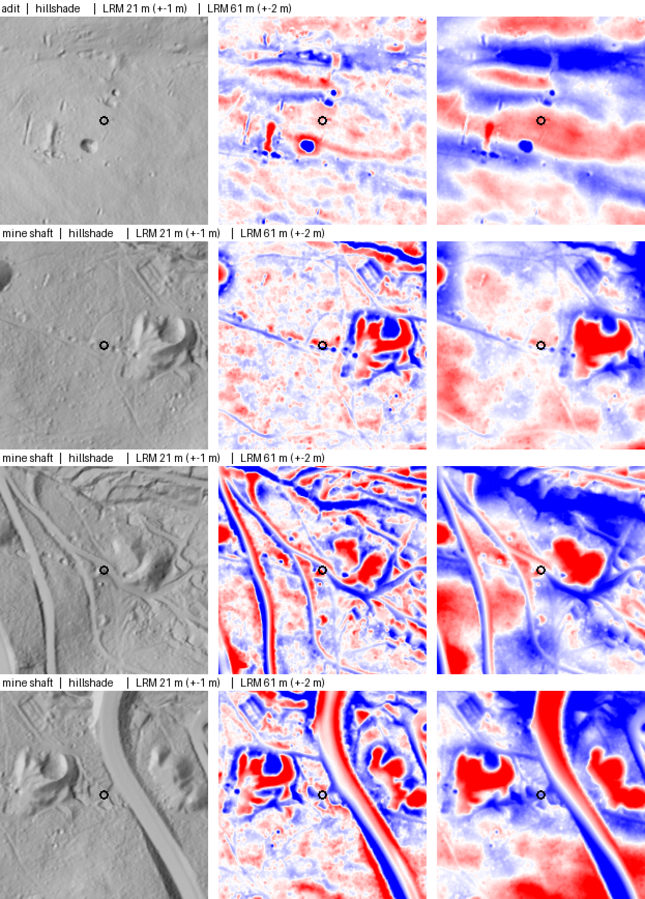

# 0009: Terrain derivatives: two-scale local relief, a provenance raster, and a seam mask

**Decision:** `terrain/derivatives.py` turns the 1 m DEM into six aligned rasters in `data/processed/terrain/`:

| Raster | Type | What it's for |
|---|---|---|
| `hillshade.tif` | uint8, multidirectional (4 suns) | Looking at the terrain, in QGIS and in review |
| `slope.tif` | uint8, whole degrees | Benches below adits are flat, dumps have 30–38° faces |
| `curvature.tif` | float32, Laplacian (1/m) | Pit floors and gully bottoms are concave-up (+) |
| `lrm_small.tif` | int16 cm, **21 m** window | **Shafts, prospect pits** (3–10 m across) |
| `lrm_large.tif` | int16 cm, **61 m** window | **Dumps, adit benches** (10–30 m) |
| `seam_mask.tif` | uint8 0/1 | 1 = don't trust derivatives here (survey seams, nodata edges) |

The DEM mosaic now also writes **`dem_source.tif`**, recording which survey tile every pixel came from. The seam mask is built from it.

## In plain words

**Local relief (LRM)** is "how far above or below its neighbourhood is this spot?", computed as elevation minus the average elevation of the surrounding window. A hillside, however steep, comes out ~0. A pit comes out negative and a dump positive. It's the single most useful layer for spotting old mine workings, because it erases the mountains and leaves the human-made bumps.

**Why two window sizes:** the window has to be bigger than the feature but smaller than the hill it sits on.
- A 21 m window makes a 5 m shaft pit stand out sharply, but a 25 m dump just looks like "a slope" inside it.
- A 61 m window shows the dump and the flat bench below an adit, but it blurs small pits into their surroundings.

So we keep both, and the Phase 3 detector looks at each feature type at its own scale.

**Seams:** the mosaic mixes surveys flown years apart (see [0007](0007-dem-acquisition-and-mosaic.md)). Where one survey's patch ends and another fills in, there's a ~0.1 m step. To the LRM, a straight 0.1 m step looks like a long, thin landform, which is exactly the kind of false positive we don't want. Rather than guessing where seams are from the elevations, the mosaic now *records* which survey supplied each pixel. A seam is wherever that changes. We mask 30 m on each side (half the large window), plus any nodata holes and the raster edge, where windows are cut off and the averages are biased.

**Masking vs blending:** we could feather (blend) surveys across a seam instead. That changes elevations to values neither survey measured, and the step is small enough (0.1 m) that losing a narrow strip costs little. Masking is honest and simple, so we start with it.

## Formally

- **LRM** = z − box_mean(z, w), computed with an integral image (O(1) per pixel for any w) and NaN-aware (mean over valid pixels only). This is the simple "difference from low-pass" LRM. Hesse's (2010) full LRM additionally interpolates a purged surface between zero contours, which reduces halo effects around big features. Revisit if halos hurt detection.
- **Quantization:** int16 centimetres (`scale = 0.01`, written to the GeoTIFF so QGIS and rasterio apply it), giving ±327 m range at 1 cm precision. That's half the size of float32, and pits are ≥ 0.3 m deep, so 1 cm loses nothing.
- **Gradients:** central differences via `np.gradient` (1 m spacing), x = east, y = north (row index runs south, so its sign is flipped).
- **Slope:** arctan(|∇z|), whole degrees. **Hillshade:** the mean of n · L over azimuths 225/270/315/360°, altitude 45°, clipped to [0, 1] per sun, mapped to 1–255, with 0 = nodata.
- **Curvature:** a 5-point Laplacian, exact for quadratic surfaces (tested on a bowl).
- **Seam mask:** max-filter ≠ min-filter of the source raster over a (2r+1)² square with r = 30, using separable 1-D passes. Outside the raster counts as source 0, so raster edges are masked too.
- **Blockwise build:** 2048 px blocks, each read with a 32 px halo using boundless reads (outside = nodata), so results are **identical** to whole-raster computation. This is tested exactly: a 64 px block build against a whole-array build. Memory stays at ~200 MB however big the AOI is.
- **Overviews** (pyramids ×2–×32) on every output and on the DEM, which closes the 0007 TODO.

## Bugs caught on the way

- **Hillshade at nodata pixels:** `np.gradient` gives a NaN pixel a finite gradient from its neighbours, so a nodata pixel got a hillshade value. It's now forced to 0.
- **Slope beside nodata** was NaN, and casting NaN to uint8 wrote garbage. It's now masked to 255.
- **Two test bugs, not code bugs:** a seam test forgot that raster edges are masked on purpose, and the blockwise test compared against float64 elevations instead of the float32 values actually on disk (a 0.0002 m difference that flipped centimetre rounding).

## Phase 2 "done when" check (2026-10-26, cell x45y444, real data)

Each row shows 200 m around a known USMIN label (circle): hillshade, then LRM 21 m (±1 m, blue = low, red = high), then LRM 61 m (±2 m). The labels are published known mines, and the crops carry no coordinates.

- **Dumps are unmistakable** in the 61 m LRM: red lobes, often with blue shaft collars in or beside them (rows 2–4).
- **Shaft and prospect pits** show as small blue dots in the 21 m LRM, e.g. the line of pits along the label's track in row 2.
- **Labels sit 20–50 m from the features**, consistent with [0008](0008-label-alignment-check.md), so snapping in Phase 3 is justified.
- **Roads** show as long paired red/blue bands (cut and fill). They're linear, which is how the detector can tell them apart.
- **Halo:** the 21 m LRM puts blue rings around big dumps (an edge-of-window effect of the simple LRM). The Phase 3 baseline should take pits from `lrm_small` only *outside* strong `lrm_large` highs, or we switch to Hesse's LRM (see Revisit).

On real data, one 10 km cell builds in about 2.5 min (mosaic 43 s, derivatives 111 s), the seam mask covers 2.7%, and the outputs total about 630 MB. **For the whole AOI, expect about 10 min and about 2.7 GB in `data/processed/terrain/`** (curvature is the largest, at float32).

**Full AOI run (Charlie's PC, 2026-10-26):** the seam/edge mask covers **2.7%** of the AOI. The CLI first printed 4.3%: it averaged per-block fractions, which over-weighted the small, heavily masked edge blocks. That's fixed with `mask_fraction` and a test. **44 of 1,370 labels (3.2%) fall inside the mask**, and 21 of those are just in the 30 m AOI edge band. That's below the few-percent threshold under *Revisit*, so we keep masking rather than feathering.

**Verdict: Phase 2's done-when is met.** Known adits' surroundings and dumps are clearly visible in the LRM.

## Where it lives

- `src/minefinder/terrain/derivatives.py`: `local_relief`, `pit_depth`, `slope_deg`, `hillshade`, `curvature`, `seam_mask`, `build_terrain`, the CLI
- `src/minefinder/acquire/dem.py`: `mosaic` now writes `dem_source.tif` + `dem_source.csv` and builds overviews
- Tests: `tests/terrain/test_terrain_build.py` and the provenance/overview tests at the end of `tests/acquire/test_dem.py`

## Revisit when

- **Detection shows halos** around large dumps in `lrm_small`: switch to Hesse's purged-surface LRM.
- **Masking removes known mines:** count labels inside `seam_mask`. If it's more than a few percent, try feathering across seams instead.
- **Point clouds (later):** a ground model rebuilt from LAZ may make seams disappear, because both surveys can be co-registered first.
- **Update (0010):** the baseline uses `lrm_small` for pits and `lrm_large` for dumps as planned here. The optional halo guard was tuned *off* on the train cell, because depth and area thresholds already remove halo artifacts.
